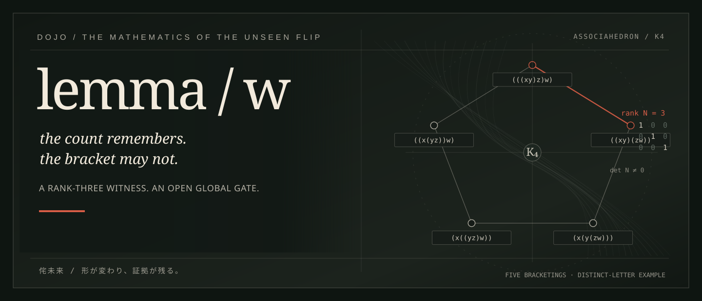
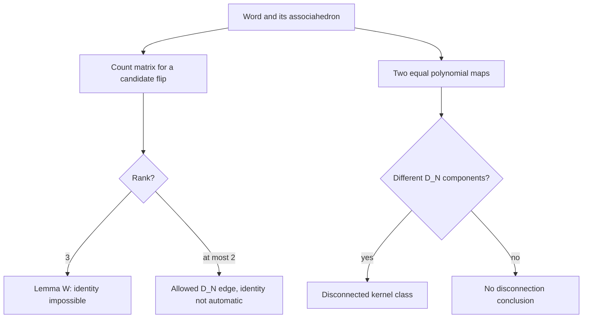

<div align="center">



<sub>侘未来 · WABI-FUTURISM / OCTONIONS × ASSOCIAHEDRA × EXACT WITNESSES</sub>

# lemma / w

### the count remembers. the bracket may not.

*One word. Many bracketings. A determinant that refuses to forget.*

**The local witness is proved. The global characterization is now proved too (manuscript argument + finite base check).**

<sub>形が変わり、証拠が残る。 · The form moves; the evidence remains.</sub>

</div>

---

## 00 / The question in a parenthesis

In the **real octonions** $\mathbb{O}$, parentheses can change the result of multiplication. But repeated letters sometimes make different bracketings define the *same polynomial map*.

For a word $w$ of length $n$, each full binary bracketing is a vertex of the **associahedron** $K_n$. A single reassociation is an edge:

$$
(AB)C\longleftrightarrow A(BC).
$$

Let $F_T$ denote the octonion polynomial map defined by a bracketing $T$, using **one variable per distinct letter**. Write

$$
T\sim T' \quad\Longleftrightarrow\quad F_T=F_{T'}.
$$

The equivalence classes are *kernel classes*. **Are the vertices belonging to each class connected by flips that are themselves polynomial identities?**

The artwork shows the five vertices and five edges of the genuine $K_4$ pentagon for the distinct-letter word $xyzw$. Its highlighted edge cannot be an octonion identity: it has a rank-three count witness. The artwork is a conceptual diagram, not a computational certificate for other words.

## 01 / Lemma W: an integer that witnesses nonidentity

Choose three **nonempty consecutive segments** $a,b,c$ of $w$, with arbitrary internal bracketings $A,B,C$.

Let $L(w)$ be the set of distinct letters. Define the **count matrix**

$$
N\in\mathbb{Z}_{\geq 0}^{\,3\times |L(w)|},
$$

where $N_{i\ell}$ is the multiplicity of letter $\ell$ in the $i$-th segment.

**Lemma W.** If $\mathrm{rank}(N)=3$, the local associator

$$
[A,B,C]=(AB)C-A(BC)
$$

is *not* identically zero as an octonionic polynomial, irrespective of the internal bracketings.

**Proof mechanism.** Rank three supplies letters $x,y,z$ with

$$
\det(N_{xyz})\ne0.
$$

Send these letters to octonionic exponentials and all others to $1$:

$$
x\mapsto\exp(\theta e_1),\qquad
y\mapsto\exp(\theta e_2),\qquad
z\mapsto\exp(\theta e_4).
$$

Trilinearity and alternation of the associator, together with its vanishing when an argument is real, give the leading term

$$
[A,B,C]=
\theta^3\det(N_{xyz})[e_1,e_2,e_4]
+\mathcal{O}(\theta^4).
$$

Because $[e_1,e_2,e_4]\ne0$, the cubic coefficient is nonzero. **The multiplicities of repeated letters survive in $N$**; a simple basis-unit sign test would lose information. Even $[x^2,y,z]$ need not vanish as a polynomial.

For $(a,b,c)=(x,y,z)$, the minor $N_{xyz}$ is the $3\times3$ identity with determinant one. The small matrix in the hero depicts exactly that illustrative instance.

[Full statement and proof details](THEOREM.md).

## 02 / Not every allowed edge is an identity

Define $D_N(w)$ as the graph of all bracketings, retaining only those flips whose three-segment count matrix has **rank at most two**.

The count witness and context cancellation imply the **one-way inclusion**

$$
E_{\mathrm{identity}}(w)\subseteq E(D_N(w)).
$$

A rank-at-most-two flip need not automatically be a polynomial identity. For special classes of words, other arguments supply the missing vanishing direction.

Hence, **two bracketings defining the same polynomial map but lying in different $D_N(w)$ components certify a disconnected kernel class**. Equality and component separation are two distinct proof obligations.


## 03 / The theorem: both directions closed

The proposed **all-length characterization** is:

> Every kernel class of $w$ is flip-connected if and only if $w$ uses at most two distinct letters, or each letter occurs in one contiguous run (*an interval word*).

Its proof status must not be flattened:

| Mathematical statement | Evidence / status |
| :-- | :-- |
| At most two distinct letters | General argument using Artin's theorem |
| **G2:** interval words have connected kernel classes | General argument in [THEOREM.md](THEOREM.md), via Propositions T, S and C |
| Complete characterization for $1\leq n\leq9$ | **Exact exhaustive finite verification** |
| Complete characterization for $10\leq n\leq14$ | **Exhaustive local certificates**: Theorem B, Proposition Q′ or Lemma R′ for every non-interval 3-letter word; [log](data/g3_upto14.log) |
| **G3:** every non-interval word on exactly three letters has a Moufang move crossing $D_N$ components | **General argument** (Theorem G3: caterpillar certificates, Lemma Cat + Proposition E; induction with an exhaustive base $R\in\{4,5\}$ runs); independently certified for every length $\leq14$ |
| **Lemma R′:** self-certifying (greatest-fixpoint) node sets are constant on $D_N$ components | General argument; certifies all G3-R counterexamples |
| **Proposition Q′:** run-comb words satisfying explicit ratio conditions are disconnected | General argument; 92.6 % of words at $n=9$ |
| **G3-R:** such a move must toggle an absolutely rigid interval | **False from length ten** |

The general only-if direction reduces to G3. The stronger G3-R has counterexamples, so it cannot be the route. Instead, nodes that fail absolute rigidity can still certify one another: deleting any of them needs a rank-3 rotation (Lemma R′). **The uniform rule is the caterpillar.**
- **Construction.** Peel the word's maximal runs off its two ends, one run or both end runs at a time, down to two runs.
- **Stability.** The path nodes are then stable under $D_N$-flips. This follows from two letter-level conditions, because every deleting rotation has two single-letter segments, so its determinant is ± a count of the third letter.
- **Existence.** An induction on the number of runs shows that a valid peeling with a Moufang move always exists. The base cases, 4 and 5 runs, are an exhaustive check over 240 cases.

See [THEOREM.md](THEOREM.md) and [`src/caterpillar.py`](src/caterpillar.py).

A corrected count from the [finite logs](data/rigid9.log) is

$$
3+19+80+286+945+2997=4330.
$$

These are the **4,330 non-interval three-letter words of lengths four through nine** covered by the finite G3 investigation. [THEOREM.md](THEOREM.md) now carries that corrected sum.

The general mathematical proofs are **manuscript arguments**, except for the parts formalized in [Lean](lean/). Those are the whole combinatorial content of G3 for all lengths (Proposition E with its finite base, Lemma Cat, Lemma R′ and the tree construction), the octonion lemmas (Moufang, Lemma W's core and expansion step, L1, Artin/Lemma V, K's restriction of flips) and parts of G2 (Proposition T's count, Proposition C (⇒), Proposition S's decoding). [Prolog](prolog/) runs the same constructive proof and checks the rest of G2 on small words. The finite classifier is exact and sampling-free within its declared range.

## 04 / The Bell-number count and its actual scope

Up to renaming letters, words of length $n$ correspond to set partitions counted by the **Bell numbers** $B_n$.

For **$1\leq n\leq14$**, the number of words with *some disconnected kernel class* is verified to equal

$$
D_n=B_n-2^n+n.
$$

The corresponding finite sequence is

$$
(D_1,\ldots,D_9)=(0,0,0,3,25,145,756,3892,20644).
$$

The certificate range continues it:

$$
(D_{10},\ldots,D_{14})=(114961,\ 676533,\ 4209513,\ 27636258,\ 190882952).
$$

For $n\leq9$ the classifier is exhaustive. For $10\leq n\leq14$ the "if" half is Theorem G2 (all $n$). The "only if" half certifies every non-interval 3-letter word, then lifts to all words by killing letters (Lemma K).

With Theorem G3 the same expression holds for **all** $n$. Its proof is a manuscript argument whose base case is a finite exhaustive check. It is not a Lean kernel proof.

The [saved exact log](data/verify9.log) includes all **26,439 words for lengths three through nine**:

$$
5+15+52+203+877+4140+21147=26439.
$$

Lengths one and two are trivial. The [CI workflow](.github/workflows/verify.yml) checks a smaller regular subset and does not rerun the nine-letter campaign on every push.

## 05 / A closed-form island: three-block words

For positive integers $a,b,c$ and three distinct letters, take the interval word

$$
w=x^a y^b z^c.
$$

Proposition T counts the connected components of its rank-allowed flip graph:

$$
\left|\pi_0(D_N(x^a y^b z^c))\right|
=1+b\left(\binom{a+c}{a}-1\right).
$$

Lemma M gives a Cayley-Dickson moment formula and Proposition S separates the components by octonion polynomial values. Proposition C extends the component description to general interval words through the induced shapes of distinct-letter triples.

This is the supplied **all-length G2 argument**. The non-interval G3 obligation is discharged separately by the caterpillar certificates (§ 03).

[Three-block algorithm](src/three_block.py) · [Moment checks](src/lemma_m.py) · [Interval-word checks](src/sigma_complete.py) · [Mathematical theorem](THEOREM.md).

## 06 / What was measured and what was proved

| Instrument | Grounded scope | Boundary |
| :-- | :-- | :-- |
| [Exact classifier](src/verify_theorem.py) | All words through length nine; [log](data/verify9.log) | Finite length, not G3 for all $n$ |
| [Full polarization](src/certify_exact.py) | Exact class checks through six; [log](data/exact6.log) | A different finite certificate |
| [ZFC-A- equational replay](https://github.com/Dojo-1/ZFC-A-) | Reported **517/517** certificates through length five | Equational steps, not a Lean proof of the global theorem |
| [Tensor cross-check](src/crosscheck.py) | Zero recorded mismatches through six; [log](data/cross6.log) | Finite implementation parity |
| [Rigid-separator study](src/rigid_separators.py) | Full finite checks through nine; [log](data/rigid9.log) | Stronger universal G3-R fails |
| [Stable-node separators](src/stable_separators.py) | Every non-interval 3-letter word through ten; [log](data/stable10.log) | Certificate search, not a uniform rule |
| [Run-comb certificates](src/run_comb.py) and [tiered G3 check](src/g3_upto14.py) | Every non-interval 3-letter word through fourteen; [log](data/g3_upto14.log) | Finite length; independent of the all-$n$ proof |
| [Lean 4 formalization](lean/) | **G3's combinatorial content for all lengths** (`g3_trees`): for every non-interval 3-letter word, bracketings related by one Moufang move that lie in different $D_N$ components. It covers Proposition E, Lemma Cat, Lemma R′ and the tree construction. Also **the octonion side G3 uses**: Moufang, alternative and flexible identities, and Lemma W's algebraic core, all proved over $\mathbb{Z}$ by a verified polynomial normaliser. No `sorry`, standard axioms only | Also proved: **Lemma W's $\theta$-expansion step**, **L1** (context cancellation), **Artin / Lemma V**, **K** (specialisation, flips restrict to flips, $D_N$ to $D_N$), Proposition T's count, Proposition C (⇒), Proposition S's decoding. Not in Lean: K's Moufang lift, T's classification, Lemma M, C (⇐) |
| [Prolog formalization](prolog/) | Same definitions as logic programs. Constructive Proposition E (44,670 certificates). Complete polarised checks of the octonion identities. **G3 end to end**: Moufang pair, Lemma Cat by brute force, exact $D_N$-components (all 4,330 words, n ≤ 9) and octonion equality; n = 10 without the exact search ([log](data/prolog_trees.log)). Lemma W's expansion, L1, Artin, K ([log](data/prolog_algebra.log)); K's Moufang lift and G2's T, M, S, C exhaustively on small words ([log](data/prolog_g2.log)) | Executable checks, not a proof assistant |
| [Caterpillar certificates](src/caterpillar.py) | Base cases $R\in\{4,5\}$ of Proposition E (exhaustive); characterization sanity check $R\leq13$; word-level validation through nine (4,330/4,330) | The induction step is a manuscript argument |
| Octonion/sedenion word spectra | Randomized numerical estimates | Neither exact proof nor guaranteed novelty |
| W, G2 and three-block statements | Proof arguments in [THEOREM.md](THEOREM.md); W, L1, Artin, K and parts of T, S, C in Lean | Lean does not yet cover K's Moufang lift, T's classification, Lemma M, C (⇐) |

A prior-art search recorded in the original notes found no matching treatment of certain repeated-letter spectra. That is **absence of a match in a bounded search**, not a priority or novelty certificate.

## 07 / Reproduce a bounded experiment

The Python tools need NumPy:

```bash
python -m pip install -r requirements.txt

python src/verify_theorem.py 7
python src/g3_check.py 8
python src/rigid_separators.py 8
python src/lemma_m.py 7 10
python src/sigma_complete.py 8
python src/stable_separators.py 8
python src/run_comb.py 8
python src/g3_upto14.py 11 14   # ~8 min
python src/caterpillar.py 12 8   # Proposition E base + validation
python src/certify_exact.py 5

# Optional: with a separate ZFC-A- checkout.
ZFCA_ROOT=/path/to/ZFC-A- python src/certs.py 5
```
The [GitHub Actions contract](.github/workflows/verify.yml) runs bounded checks on pushes. Its ordinary verifier is capped at length seven; the larger archived logs are not CI results for every new commit.

**No mathematical computations were rerun merely to author this documentation redesign.**

## 08 / Provenance and the still-unanswered word

The mathematical foundations include Artin's theorem for alternative algebras, Moufang identities, octonion multiplication, Catalan/associahedral combinatorics and the literature on associative spectra. This research grew from the kernel quotient of an associahedron through a Tendril ([Tendrils](https://github.com/Dojo-1/Tendrils)), with certificate interfaces from [ZFC-A-](https://github.com/Dojo-1/ZFC-A-).

The [verbatim original README](docs/README_MAIN_SNAPSHOT_2026-11-18.md) preserves the longer numerical and prior-art account. **No license is currently declared** in this repository; none is inferred or supplied by this edit.

Evidence remains typed: **P** — mathematical proof in the supplied manuscript; **P-fin** — exhaustive exact finite procedure; **M** — measured experiment; **H** — conjecture; **R** — refuted stronger candidate.

**The universal gate G3 is closed by caterpillars.** Its combinatorial core, Proposition E for all lengths together with its finite base, is now checked by the Lean kernel. Lemma Cat, Lemma R′, the tree construction (`g3_trees`), the Moufang identities and Lemma W's algebraic core are machine-checked too. Lemma W's $\theta$-expansion, context cancellation, Artin's theorem and killing (K) are now Lean theorems too, with Proposition T's count, Proposition C (⇒) and Proposition S's decoding. Still on paper (checked in Prolog on small words): K's Moufang lift, Proposition T's classification, Lemma M and Proposition C (⇐).

---

<div align="center">

### 間 — ma

*Between two equal maps and a path of equalities, the determinant remembers.*

**the count remembers. the bracket may not.**

<sub>LEMMA / W · LOCAL WITNESS, GLOBAL CLOSURE</sub>

</div>
